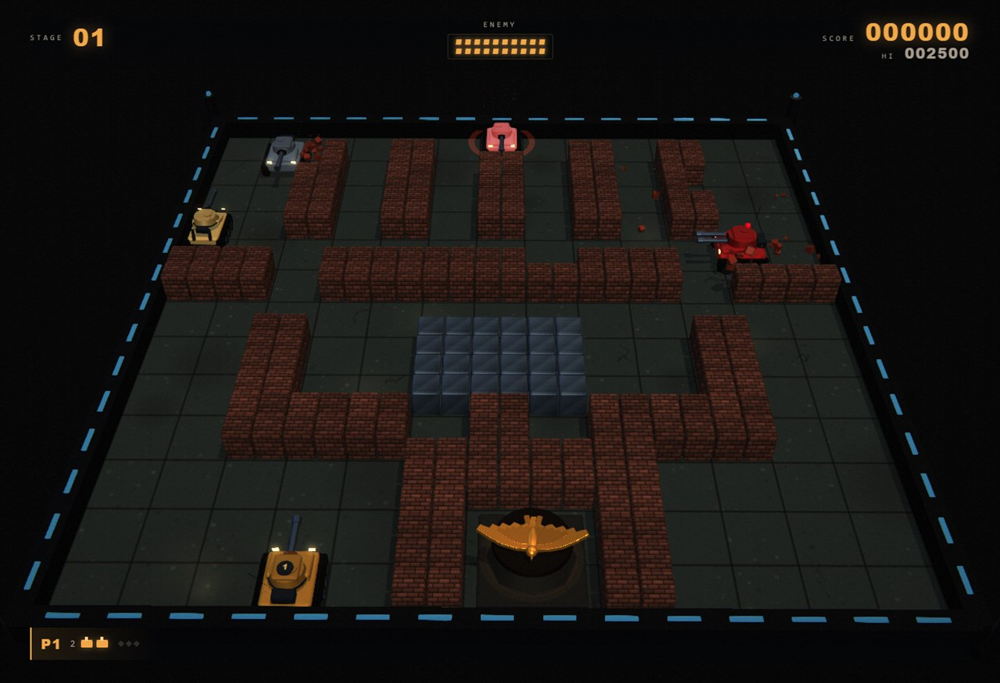
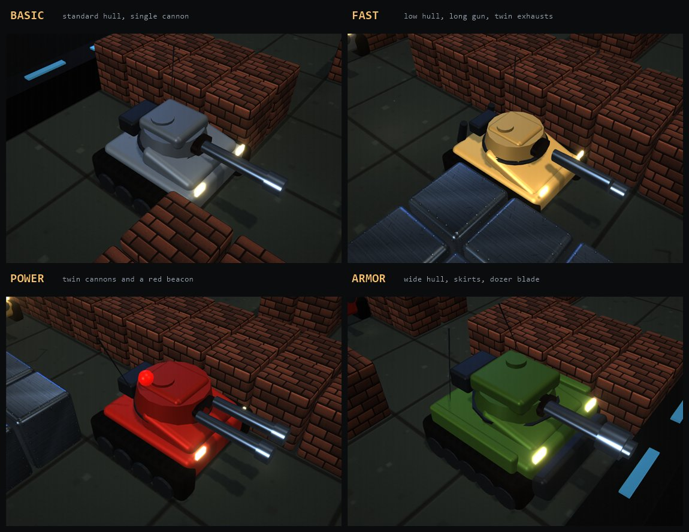

# Battle City — Reforged

A modern remake of the NES classic *Battle City* built with Three.js, TypeScript, and Vite.
All art, models, textures, particles, music, and sound effects are generated procedurally — no
external game assets are used.



## Run it

```bash
npm install
npm run dev
```

Open the URL Vite prints (defaults to http://localhost:5173).

Production build / preview:

```bash
npm run build
npm run preview
```

Tests:

```bash
npm test
```

## Controls

| Action | Player 1 | Player 2 |
| --- | --- | --- |
| Move | Arrow keys | W A S D |
| Fire | Space | F |
| Pause | P / Esc | P / Esc |
| Mute | M | M |
| Start / retry | Enter (menu), R (game over) | — |

Gamepads are supported: left stick / d-pad to move, A / X / RT to fire, Start to deploy,
Back / Select to pause.

## What's inside

- Faithful 13×13 playfield with brick, steel, water, forest, ice, and the eagle base.
- Quadrant-level brick and steel destruction; bullets, ricochets, and base damage.
- Four enemy classes with distinct hulls, turrets, and armaments — see below.
- Enemy AI re-routes when blocked and shells brick walls in its path, so tanks do not lock up
  against terrain.
- Spawn queues, bonus tanks, and the full 35-stage loop (10 handmade maps, then seeded
  procedural stages with scaling difficulty).
- Power-ups: star, helmet, clock, shovel, grenade, and extra tank.
- Single-player and two-player local co-op, shared stage flow, lives, respawns, and scoring.
- PBR materials with procedural colour, normal and roughness maps; the ground, brick and
  steel all respond to a raking key light with real shadow casting.
- Night-time arena framed by sandbags, crates, barrels, floodlights and a ruined skyline,
  with ACES tone mapping, bloom, colour grading, SMAA, animated water/ice, and forest canopies.
- Physics-driven particles: debris, sparks, smoke, shockwave rings, scorch decals, muzzle
  flashes, camera shake, and screen flashes.
- Weather per sector — drifting embers, slanted rain with lightning, or falling snow — each
  with its own fog, light mood and ground wetness.
- Synthesized WebAudio sound effects, engine loop, and original chiptune music with a mute
  toggle.

## Enemy classes



| Class | Silhouette | Behaviour |
| --- | --- | --- |
| Basic | Grey, standard hull, single cannon | Baseline speed and reload. |
| Fast | Sand paint, low hull, long gun, twin exhausts | Fastest tank in the field; outruns and flanks. |
| Power | Crimson, twin cannons, pulsing red beacon | High-velocity shells and the shortest reload. |
| Armor | Olive, wide hull, side skirts, dozer blade, twin antennas | Takes four hits; advances slowly and relentlessly. |

Each class uses its own hull, track layout, turret, and gun combination, so they are
recognisable at a glance even before the paint job registers.

## Project layout

```
src/core/     Pure game simulation (no Three.js dependency)
src/render/   Scene, models, terrain, effects, procedural textures
src/audio/    Synthesized SFX and chiptune scheduler
src/input/    Keyboard and gamepad input
src/ui/       HUD, menus, overlays, banners
src/main.ts   Wiring, fixed-timestep loop, debug hook
test/         Core simulation tests
```

The simulation is deterministic per seed and emits `GameEvent`s; the renderer and audio engine
consume those events. The fixed step keeps movement, collisions, and enemy AI independent of
frame rate.

## Debug hook

`window.__battleCity` exposes `game`, `view`, `audio`, `hud`, `input`, `start(mode)`, and
`advance(seconds)` for automation and visual inspection. `view.inspect(x, z, distance)` parks the
camera next to a world position and `view.clearInspect()` restores the gameplay camera.

## Legal

This is a non-commercial fan tribute to *Battle City* (Namco, 1985). It is not affiliated with or
endorsed by Namco. No original game assets, sprites, audio, or level data are included — all code,
models, textures, music, and sound effects are original and generated at runtime or build time.

